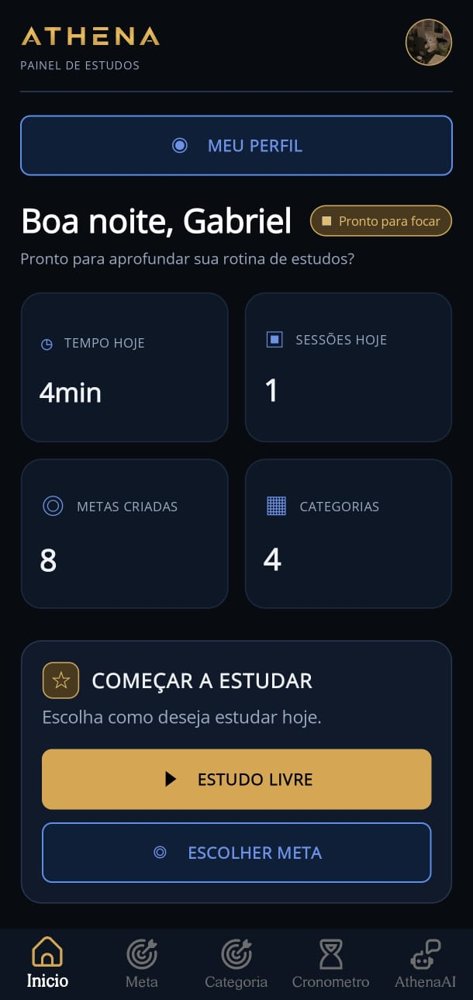
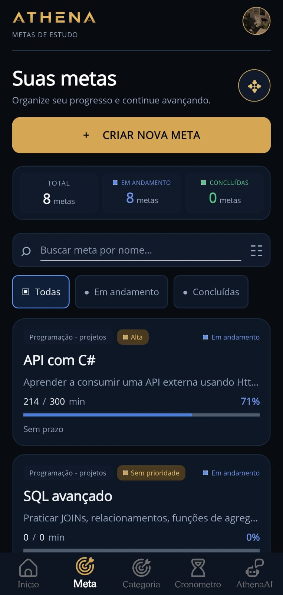
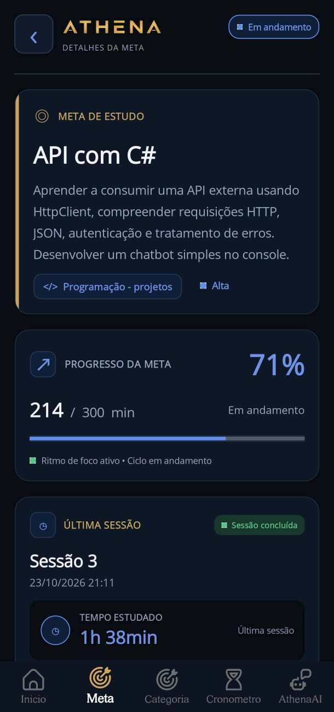
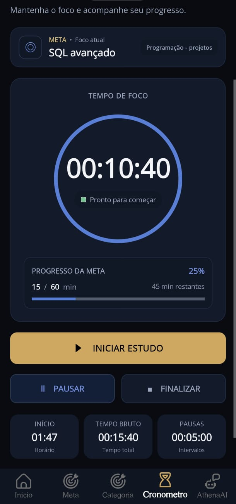
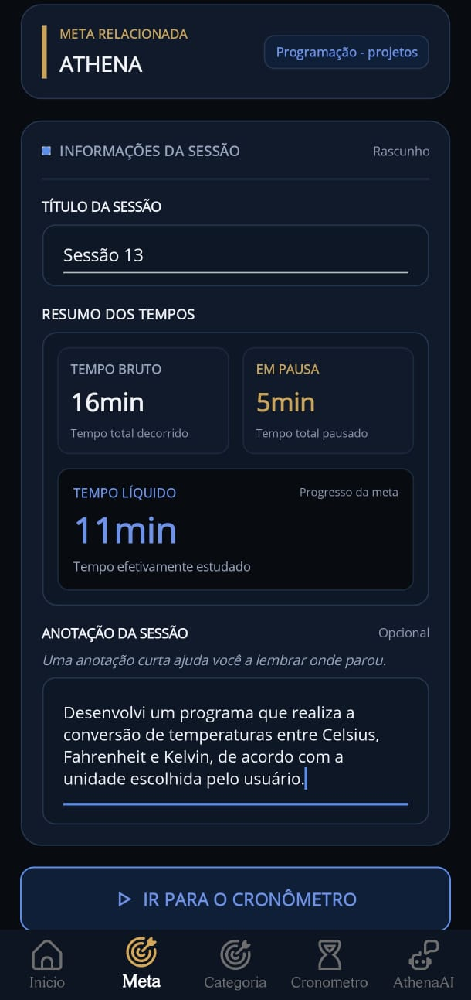
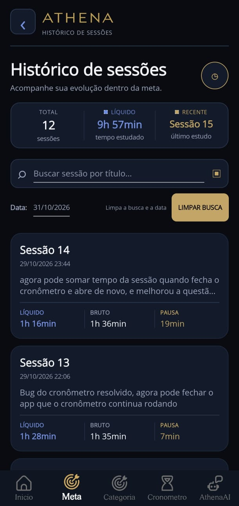
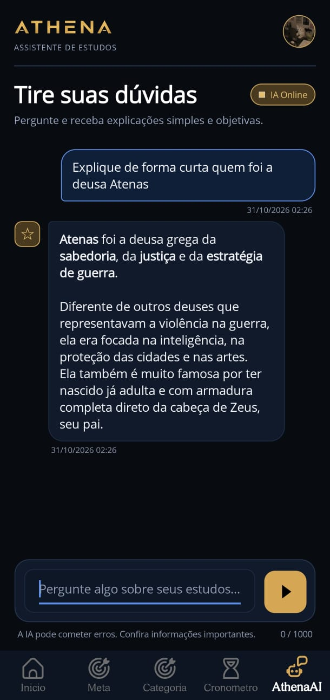
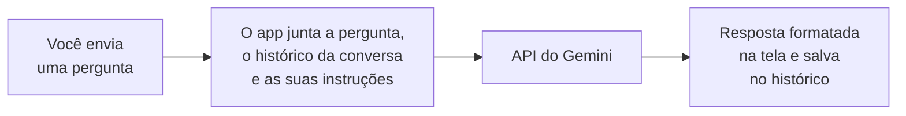

<p align="center">
  
</p>

<h1 align="center">ATHENA</h1>

<p align="center">
  <strong>Aplicativo Android para organizar os estudos:</strong><br>
  marque quanto tempo estudou, registre <em>o que</em> estudou e acompanhe suas metas.
</p>

<p align="center">
  
  
  
  
  
  
  
</p>

<p align="center">
  <a href="https://github.com/DeividGabrielLeandro/ATHENA-Aplicativo/releases/latest"><strong>Baixar o APK</strong></a>
  ·
  <a href="#como-instalar">Como instalar</a>
  ·
  <a href="https://github.com/DeividGabrielLeandro/Sistema-de-Estudo-CSharp">Versão terminal</a>
</p>

---

## Telas

<table>
  <tr>
    <td align="center"><br><sub>Início</sub></td>
    <td align="center"><br><sub>Metas</sub></td>
    <td align="center"><br><sub>Detalhes da meta</sub></td>
    <td align="center"><br><sub>Cronômetro</sub></td>
  </tr>
  <tr>
    <td align="center"><br><sub>Sessão com anotação</sub></td>
    <td align="center"><br><sub>Histórico de sessões</sub></td>
    <td align="center"><br><sub>Athena AI</sub></td>
    <td></td>
  </tr>
</table>

> Os registros do histórico são reais: usei o próprio ATHENA para registrar o desenvolvimento do ATHENA.

---

## Por que o ATHENA existe

Eu estudava com um aplicativo de cronômetro. Ele mostrava **quanto tempo** eu tinha estudado, mas não guardava **o que** eu tinha estudado. Eu sabia o número de horas, mas, quando voltava aos estudos, não lembrava exatamente o que tinha feito em cada dia nem qual era o próximo passo.

O ATHENA nasceu dessa necessidade. Além de contar o tempo, ele organiza os estudos em **metas** e **categorias**, divide cada meta em **sessões** e deixa você escrever o que fez em cada uma. Assim dá para voltar a qualquer dia, saber exatamente o que foi estudado e ter um norte para continuar.

```text
Categoria   Programação
└── Meta    API com C#  ·  objetivo de 300 min  ·  prioridade Alta
    └── Sessão 3   1h 38min estudados
        └── Anotação   "Fiz a primeira requisição com HttpClient e li o JSON da resposta."
```

Na prática, o ATHENA é um **organizador de tarefas voltado para estudo**: qualquer objetivo que se mede em tempo de dedicação cabe nele.

## Para quem é

- **Estudantes** de escola, curso técnico, faculdade, vestibular ou concurso que querem saber para onde vai o tempo de estudo.
- **Autodidatas** (programação, idiomas, música) que precisam lembrar onde pararam.
- **Quem já estuda com cronômetro** e quer mais do que um número de horas.
- **Qualquer pessoa com objetivos medidos em tempo**, como projetos pessoais, leitura ou o treino de uma habilidade.

---

## Funcionalidades

### 🏠 Início

- Saudação com o seu nome e o status do foco (*Foco Ativo* ou *Pronto para focar*)
- Tempo estudado hoje e sessões de hoje
- Total de metas e de categorias
- Atalhos para começar: **Estudo livre** ou **Escolher meta**

### 🎯 Metas

- Criar, editar e excluir metas
- Objetivo de tempo em minutos, com barra de progresso e porcentagem
- Prioridade, data limite e categoria (opcionais)
- Status **Em andamento** ou **Concluída**
- Busca por nome e filtros (Todas, Em andamento, Concluídas)
- Tela de detalhes com o progresso e a última sessão

### 📂 Categorias

- Criar, editar e excluir categorias
- Adicionar e remover metas de uma categoria
- Ver as metas de cada categoria, com o tempo estudado e filtros por status

### ⏱️ Cronômetro

Três formas de estudar:

- **Estudo livre:** conta o tempo sem meta. Ao finalizar, vira uma sessão chamada *Estudo livre*.
- **Meta:** o tempo estudado soma direto no progresso da meta.
- **Sessão:** o tempo soma na meta e na sessão. Dá para rodar o cronômetro várias vezes na mesma sessão, e o tempo vai se acumulando.

Em todas elas:

- Iniciar, pausar, continuar e finalizar
- **Tempo bruto** (total), **pausas** e **tempo líquido** (o tempo realmente estudado, que é o que conta para a meta)
- O cronômetro continua certo mesmo se o Android fechar o app em segundo plano

### 📝 Sessões de estudo

- Cada meta é dividida em sessões
- Cada sessão guarda um título, uma anotação do que foi estudado e os tempos (bruto, pausas e líquido)
- Histórico de sessões por meta, com busca por título e filtro por data
- Resumo do histórico: total de sessões, tempo estudado e sessão mais recente

### 👤 Perfil

- Nome e foto de perfil
- Meta diária de estudo, com o progresso do dia
- Sequência de dias estudados, tempo total e número de sessões
- Configuração da Athena AI

### 🤖 Athena AI

- Chat para tirar dúvidas, resumir textos, criar quizzes e pedir dicas de estudo
- Sugestões prontas para começar a conversa

---

## Como funciona a Athena AI

A Athena AI usa a **API do Gemini**, do Google. Cada pessoa usa a **própria chave de API**, que pode ser criada de graça no Google AI Studio. O passo a passo está dentro do app, na tela de Perfil.



- **Chave protegida:** a chave fica no armazenamento seguro do Android (`SecureStorage`). Ela não está no código nem no repositório.
- **Você escolhe o modelo:** a lista mostra modelos de texto do Gemini com uso gratuito.
- **Você define o jeito de responder:** o campo *Como a IA deve responder* vira as instruções de sistema enviadas ao Gemini, por exemplo "explique passo a passo com linguagem simples".
- **Memória da conversa:** as mensagens ficam salvas no SQLite do aparelho e vão junto com cada pergunta, para a IA entender o contexto. Quando a conversa passa de 24 horas, ela é apagada e começa do zero.
- **Respostas formatadas:** o app converte o Markdown que o Gemini devolve (títulos, negrito e código) em texto formatado do .NET MAUI.
- **Limites:** perguntas de até 1.000 caracteres e respostas curtas, de até 800 tokens.

> No plano gratuito, o Google pode usar o conteúdo enviado para melhorar os produtos dele. O app avisa isso na tela de configuração.

---

## Como instalar

1. Baixe o arquivo `ATHENA-v1.0.apk` na página de [Releases](https://github.com/DeividGabrielLeandro/ATHENA-Aplicativo/releases/latest).
2. Abra o arquivo no celular. Se o Android pedir, permita **instalar apps desconhecidos** para o navegador ou o gerenciador de arquivos.
3. Se o Play Protect avisar que o app é desconhecido, toque em **Mais detalhes** e depois em **Instalar mesmo assim**. O aviso aparece porque o ATHENA não está na Play Store.

Bom saber:

- Requer Android 5.0 ou superior.
- Os dados ficam **somente no aparelho**, sem login e sem nuvem. Desinstalar o app apaga tudo.
- Só a Athena AI precisa de internet. O resto do app funciona offline.

### Rodar a partir do código

Pré-requisitos:

- Visual Studio 2026 com a carga de trabalho do **.NET MAUI** (.NET 10)
- Um celular Android com a depuração USB ativada ou um emulador

```bash
git clone https://github.com/DeividGabrielLeandro/ATHENA-Aplicativo.git
```

Abra o `ATHENA.slnx` no Visual Studio, escolha o dispositivo Android e rode o projeto.

Para gerar o APK:

```bash
dotnet publish -f net10.0-android -c Release
```

O arquivo sai em `bin/Release/net10.0-android/publish/ATHENA-v1.0.apk`.

---

## Tecnologias e ferramentas

| Área | Tecnologia |
|---|---|
| Linguagem | C# |
| Plataforma | .NET 10 e .NET MAUI (Android) |
| Interface | XAML |
| Banco de dados | SQLite, com `sqlite-net-pcl` |
| Persistência leve | `Preferences` (estado do cronômetro e configurações da IA) |
| Segurança | `SecureStorage` (chave da API) |
| Inteligência artificial | API do Gemini, com `HttpClient` e `System.Text.Json` |
| IDE | Visual Studio 2026 |
| Controle de versão | Git e GitHub |
| Assistente de desenvolvimento | Claude Code |

### Uso de IA no desenvolvimento

Usei o **Claude Code** como ferramenta de apoio, junto com o Visual Studio e o GitHub:

- **Interface:** ajudou a criar e aprimorar o visual das telas em XAML.
- **Lapidação do código:** revisou e padronizou o projeto, com tratamento de erros (`try/catch`), remoção de código sem uso e de comentários desnecessários, uma formatação única para durações e documentação XML das partes centrais.
- **Correções e revisão:** corrigiu problemas menores e revisou as minhas correções dos bugs principais, como o cronômetro que perdia o tempo quando o Android fechava o app e o tempo de sessão que era sobrescrito em vez de somado.
- **Publicação:** ajudou a preparar o APK da versão 1.0, com nome, ícone e tela de abertura.

---

## Estrutura do projeto

```text
ATHENA
├── AthenaAI/        Chat com o Gemini, configurações da IA e formatação das respostas
├── Categorias/      Telas de categorias: listar, criar, editar e detalhes
├── Database/        Tabelas do banco SQLite
├── Metas/           Telas de metas: escolher, criar, editar e detalhes
├── Models/          Regras e acesso ao banco (metas, categorias, sessões, cronômetro e usuário)
├── SessaoEstudo/    Tela da sessão e histórico de sessões
├── Services/        Estado do cronômetro, salvamento no Preferences e formatação de tempo
├── Platforms/       Código e recursos específicos de cada plataforma
├── Resources/       Ícone, tela de abertura, fontes, imagens e estilos
├── docs/            Imagens deste README
├── AppShell.xaml    Abas e rotas de navegação
├── MainPage.xaml    Tela de início
├── Cronometro.xaml  Tela do cronômetro
├── PerfilPage.xaml  Perfil, meta diária e configuração da IA
└── MauiProgram.cs   Inicialização do app
```

---

## Decisões técnicas

### Um cronômetro que sobrevive ao Android

O Android pode encerrar um app em segundo plano a qualquer momento. No começo, o cronômetro vivia só na memória e, quando isso acontecia, o tempo era perdido. Cheguei a perder uma hora de estudo assim.

A solução foi parar de "contar segundos" e passar a **guardar horários**: o início do estudo, o início do trecho atual e o tempo líquido já acumulado. Esses dados são salvos no `Preferences` a cada início, pausa ou continuação. Quando o app abre de novo, o tempo é recalculado pela diferença entre os horários, como se o app nunca tivesse fechado.

### Tempo que soma, e não sobrescreve

Uma sessão pode ter vários trechos de cronômetro. Cada trecho **soma** o tempo na sessão e na meta, em vez de substituir o valor anterior. Esse salvamento acontece dentro de uma **transação** do SQLite: a meta, a sessão e o registro de tempo são atualizados juntos, ou nada é salvo. Assim o tempo não se perde nem é contado duas vezes.

### Limpeza de sessões vazias

Se uma sessão é criada e o cronômetro nunca roda, ela ficaria vazia no histórico. Ao abrir o app, o ATHENA apaga essas sessões, sem tocar na sessão que está com o cronômetro em andamento.

### Tempo guardado com precisão

Os minutos estudados são guardados como `double`, para não perder os segundos, e todas as telas usam o mesmo formatador (`FormatadorTempo`) para mostrar durações como `45s`, `12min` ou `1h 38min`.

### Navegação

O app usa o **Shell** do .NET MAUI, com cinco abas (Início, Meta, Categoria, Cronômetro e AthenaAI) e rotas com parâmetros (`QueryProperty`) para abrir uma meta ou sessão específica. Na tela da sessão, o botão voltar do Android pergunta antes de descartar uma sessão que já tem tempo registrado.

---

## Do terminal ao aplicativo

O ATHENA começou como uma [aplicação de terminal](https://github.com/DeividGabrielLeandro/Sistema-de-Estudo-CSharp) em C# e SQL Server. A versão terminal chegou à **v1.1**, e o roadmap dela apontava a próxima etapa: a *ATHENA 2.0 — Versão Aplicativo*.

Este repositório é essa evolução. Como é um produto novo, a numeração recomeça na **v1.0**. O roadmap previa Windows Forms ou WPF; no fim, o ATHENA foi para o celular com .NET MAUI.

| | Versão terminal (v1.1) | Aplicativo (v1.0) |
|---|---|---|
| Interface | Console, com Spectre.Console | Telas em XAML, com .NET MAUI |
| Plataforma | Computador | Celular Android |
| Banco de dados | SQL Server | SQLite, no próprio aparelho |
| Usuários | Cadastro e login com senha (BCrypt) | Sem login, um perfil por aparelho |
| Cronômetro | `Stopwatch` em memória | Horários salvos, sobrevive ao app fechar |
| IA | Não tinha | Athena AI, com Gemini |

Em vez de fazer vários projetos pequenos e abandoná-los, escolhi um projeto que evolui junto com o que eu aprendo. Cada versão do ATHENA é uma etapa desse caminho.

---

## Habilidades e o que aprendi

Antes do ATHENA, eu já programava em C#, mas só no terminal. Quase tudo o que está neste aplicativo eu aprendi construindo ele.

### Habilidades usadas

| Habilidade | Como usei no ATHENA |
|---|---|
| **XAML** | Construção de todas as telas: layouts, estilos e listas com `CollectionView` |
| **.NET MAUI** | Ciclo de vida das páginas (`OnAppearing`, botão voltar), navegação com Shell e recursos do celular, como a galeria de fotos e o navegador |
| **SQLite** | Modelagem das tabelas (metas, categorias, sessões, registros de tempo e mensagens da IA), CRUD, consultas com LINQ e transações |
| **Persistência com `Preferences`** | Estado do cronômetro e configurações da IA, que precisam sobreviver ao app fechar |
| **`SecureStorage`** | Guardar a chave da API com segurança |
| **Consumo de API** | Criação da chave no Google AI Studio, requisições HTTP com `HttpClient`, montagem e leitura de JSON e tratamento de erros da API do Gemini |
| **Programação assíncrona** | `async`/`await` no acesso ao banco e à API, sem travar a tela |
| **Tratamento de erros** | `try/catch` nas telas, com mensagens para o usuário |
| **Depuração** | Encontrar e corrigir bugs que só aparecem no celular, como o Android fechando o app em segundo plano |
| **Documentação** | Comentários XML nas partes centrais do código |
| **Git e GitHub** | Commits, branches, merge, tags e releases |
| **Publicação Android** | Ícone, tela de abertura, identificador do app e geração do APK |

### O que aprendi

- **Juntar tudo.** O maior desafio não foi cada peça sozinha, e sim fazer interface, banco de dados, navegação entre telas, persistência e uma API externa funcionarem juntos com o C#.
- **Pensar como o celular funciona.** Um app de celular pode ser fechado a qualquer momento. Aprendi a salvar o estado em vez de confiar que o app vai continuar aberto.
- **Resolver problemas de verdade.** Bugs como o tempo perdido em segundo plano e o tempo de sessão sobrescrito me ensinaram a investigar a causa, testar no aparelho e corrigir sem quebrar o resto.
- **Trabalhar com uma API.** Criar a chave, montar as requisições, entender o formato do JSON e lidar com respostas e erros.
- **Usar IA como ferramenta.** Usar o Claude Code para acelerar a interface e revisar o código, mantendo comigo as decisões e as correções principais.

---

## Roadmap

Possibilidades para as próximas versões:

- [ ] Backup e exportação dos dados (hoje eles ficam só no aparelho)
- [ ] Estatísticas por semana e por mês, com gráficos
- [ ] Calendário de estudos
- [ ] Notificação mostrando o cronômetro em andamento
- [ ] Gamificação
- [ ] Versão para Windows
- [ ] Testes automatizados

> **Observação:** o roadmap mostra a direção atual do ATHENA. As prioridades podem mudar conforme novas necessidades e aprendizados surgirem.

---

## Versão

**Versão atual:** `v1.0`<br>
**Status:** primeira versão do aplicativo concluída, em evolução<br>
**Versão anterior:** [ATHENA v1.1 — Versão Terminal](https://github.com/DeividGabrielLeandro/Sistema-de-Estudo-CSharp)

## Autor

Feito por **Deivid Gabriel Leandro**: [GitHub](https://github.com/DeividGabrielLeandro)
